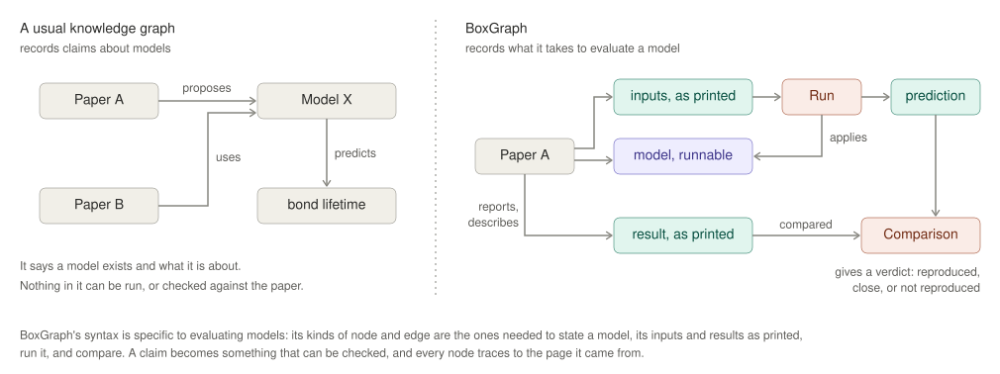
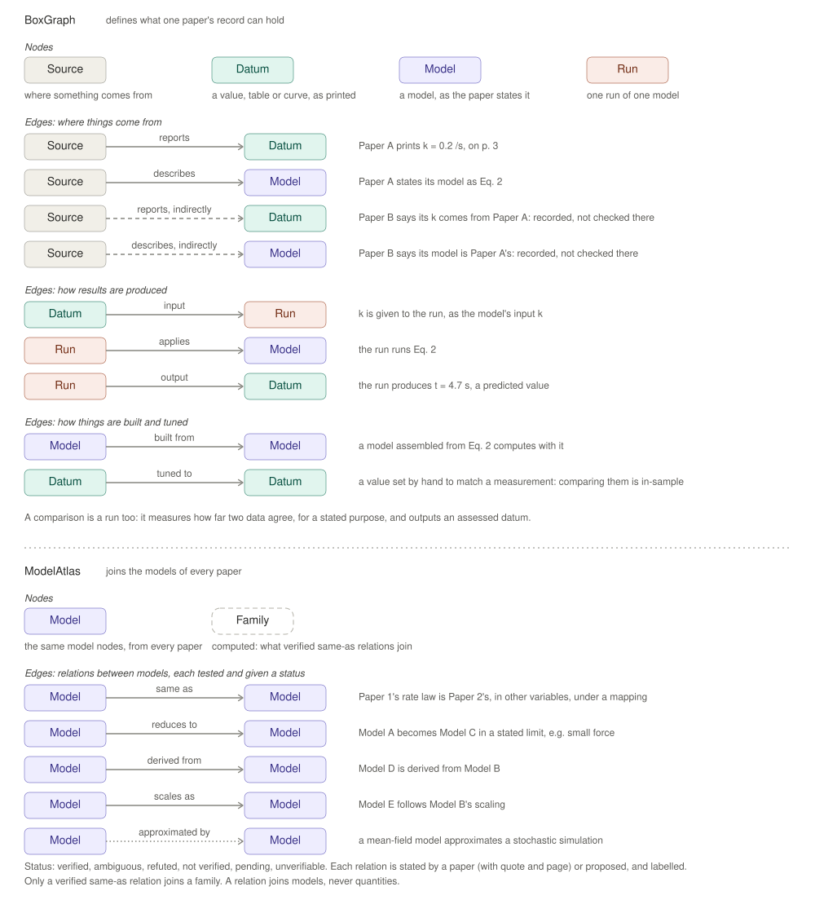
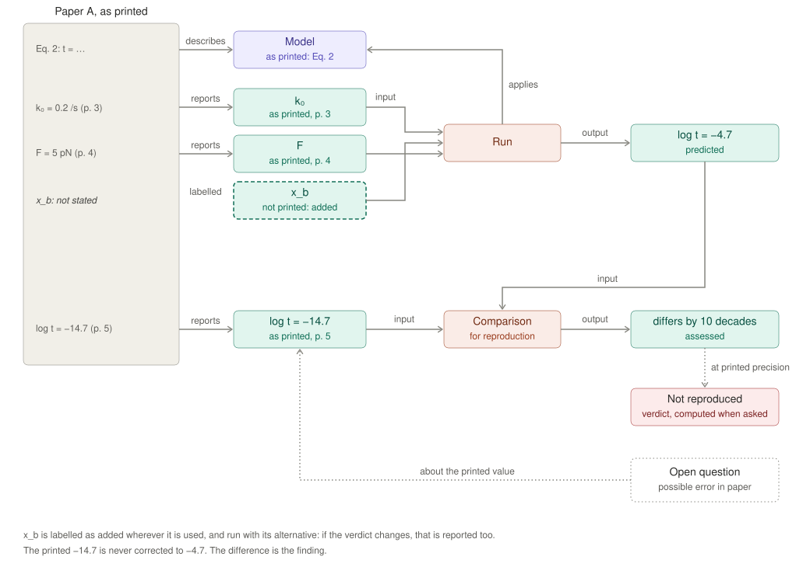
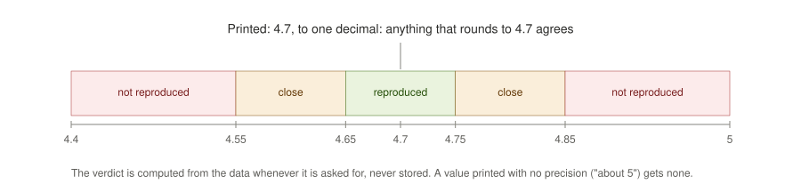
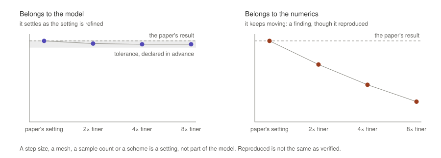
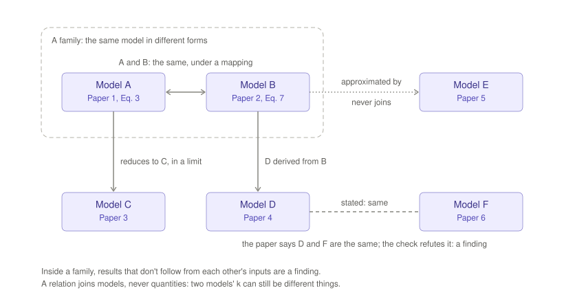
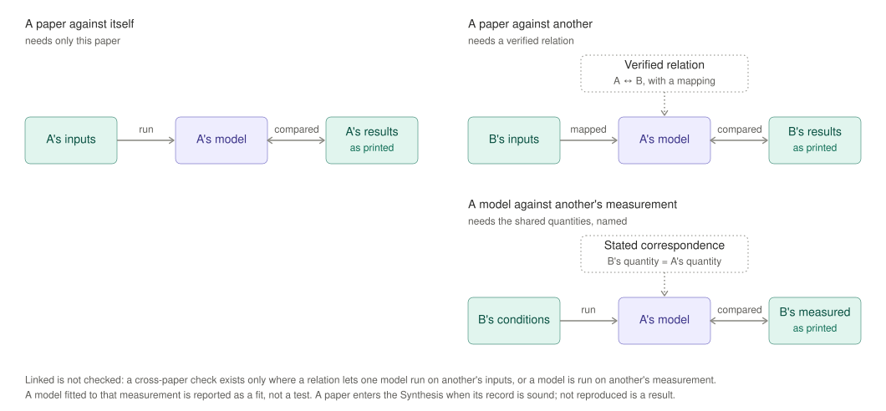

# BoxGraph

> [!WARNING]
> **Work in progress.** BoxGraph and its corpora are under active development, and the
> format, the code and the results may still change. The records are written by agent jobs
> and checked by the validator, but not yet by people. Treat a verdict as a pointer to where
> a paper and its rebuild disagree, not as a finding about the paper, and check the record
> before citing it.

> All models are wrong, but some are useful. — George E. P. Box

Papers build on each other's models and parameter values, but the links are
made in prose and rarely checked, so errors propagate and corrections arrive
slowly. BoxGraph is an executable literature review. Each paper's models are
rebuilt as stated, run on the paper's own inputs, and compared with what the
paper reports and with what other papers measured. Relations between models
in different papers are tested rather than assumed. The result is a record of
where each model holds and where it does not, not a judgement of which model
is correct.

The record is rebuilt each time a source is added, and nothing in it is
overwritten: a disagreement is kept as a result, and a finding in one paper
flags every result elsewhere that depends on it.

- **BoxGraph**: the record format for one source (a paper, its released code,
  or its data) and the validator for it. A record holds every value as printed,
  with its unit, quantity and page; every model as runnable code with declared
  inputs and outputs; the runs of those models; and the comparisons between
  computed and printed values.
- **ModelAtlas**: every model of every source, linked by relations (same as,
  reduces to, derived from, scales as, approximated by), each tested numerically
  or symbolically. Models verified to be the same under a mapping form a family.
- **The Synthesis**: what the build computes from all records: a verdict for
  every comparison at the precision the value was printed with, checks of values
  one paper takes from another, models run on other papers' inputs and judged
  against their measurements, findings,
  and the open questions they raise.

## The Synthesis so far

This repository ([elejeune11/boxgraph-lepidoptera](https://github.com/elejeune11/boxgraph-lepidoptera),
adapted from [elejeune11/boxgraph-public](https://github.com/elejeune11/boxgraph-public))
builds an executable literature review of **actin bundling, phase separation, cortical patterning, and butterfly wing-scale mechanics**
in [`corpora/actin_bundling/`](corpora/actin_bundling/papers.yaml) (**69 sources**: **52 papers** spanning 1996–2025, 100% of their
Supplemental Information including converted Word SI files, and **17 released code and Source Data attachments**; `685/685` pipeline jobs gated).

Its interactive overview page is generated by `boxgraph build` (`build/actin_bundling/overview/index.html`,
copied to `site/actin_bundling/` by `make build site CORPUS=actin_bundling` and published via GitHub Pages at
[https://elejeune11.github.io/boxgraph-lepidoptera/](https://elejeune11.github.io/boxgraph-lepidoptera/)); every number on it comes from
the audited records.

## Contents

1. [The Synthesis so far](#the-synthesis-so-far): the interactive overview of the actin bundling review
2. [The design](#the-design): what BoxGraph, ModelAtlas and the Synthesis are
   - [1 · The goal](#1--the-goal)
   - [2 · BoxGraph](#2--boxgraph)
   - [3 · ModelAtlas](#3--modelatlas)
   - [4 · The Synthesis](#4--the-synthesis)
   - [5 · How it is built](#5--how-it-is-built)
3. [The pipeline and the implementation](#the-pipeline-and-the-implementation): how papers are read into records
4. [Papers in the Synthesis](#papers-in-the-synthesis): the running list
5. [Install](#install), [Use](#use), [Layout](#layout), [A record](#a-record)
6. [Adding papers](#adding-papers): papers, released code and source data
7. [Status](#status)

---

## The design

The design is in [`docs/minimalist_design/`](docs/minimalist_design/README.md),
and it wins over the code. Documents 1 to 4 say what is built and why, and
deliberately say nothing about how the code is written or how agents read;
document 5 fixes the few requirements on the build itself.

| Document | In brief |
|---|---|
| [1 · The goal](docs/minimalist_design/01-goal.md) | The problem (links between papers are made in prose, so errors travel), what we build instead, and the thirteen principles everything else follows. |
| [2 · BoxGraph](docs/minimalist_design/02-boxgraph.md) | The record: four kinds of node, their edges, origins and labels; how one paper becomes a graph; verdicts at the printed precision; values read from figures; code and data as sources; the model against its numerics. |
| [3 · ModelAtlas](docs/minimalist_design/03-modelatlas.md) | Every model kept as its paper states it, joined by five kinds of tested relation; families of models that are the same under a mapping. |
| [4 · The Synthesis](docs/minimalist_design/04-synthesis.md) | What the review holds: verdicts, cross-paper checks, cited values, findings, implications and references; a paper checked against itself and against others. |
| [5 · How it is built](docs/minimalist_design/05-building.md) | Test-driven development, how figures must be read, and why each record keeps the code that reads its figures. |

The figures are generated by
[`make_figures.py`](docs/minimalist_design/figures/make_figures.py).

### 1 · The goal

Quantitative papers build on each other's numbers and models, but nobody
checks that a paper's printed results follow from its own equations, or that
a later paper's "same model" is the same. BoxGraph records what each paper
states, runs what follows from it, tests how papers relate, and reports what
the literature shows as a whole. It checks **consistency, not truth**.
[Read the full document →](docs/minimalist_design/01-goal.md)



*Figure 1. A usual knowledge graph records claims about models, and nothing in
it can be run. BoxGraph gives it a syntax made for evaluating models: the
paper's inputs and results as printed, its model in runnable form, a run, and
a comparison.*

### 2 · BoxGraph

A record has four kinds of node (Source, Datum, Model, Run). A comparison is
a run too, and its output is assessed like any other datum. Every datum has
an origin and a citation. Anything the paper doesn't state is added and
labelled, with its alternatives. A paper's released code and source data are
sources with records of their own, cited by file and line or by sheet and
cell. Verdicts are computed at the precision the paper printed; a near miss
is judged again with the rounding of the printed inputs. An evidently
misprinted equation is run as printed and as a corrected variant, reported
apart. A result that rests on a simulation is checked as its numerical
settings are refined.
[Read the full document →](docs/minimalist_design/02-boxgraph.md)



*Figure 2. The nodes and edges BoxGraph defines, and those ModelAtlas adds.*



*Figure 3. What a paper prints becomes nodes; an input it doesn't print is
added and labelled; a run and a comparison lead to a verdict and an open
question.*



*Figure 4. A value printed as 4.7 allows 4.65 to 4.75. Outside it by no more
than its width again it is close, if it keeps the sign and is within a
factor of ten; beyond that it is not reproduced.*



*Figure 5. Two results that both reproduce at the paper's own setting. As the
setting is refined, one settles (it belongs to the model) and one keeps
moving (it belongs to the numerics, a finding).*

### 3 · ModelAtlas

Each paper's model is a chart, entered as stated. A tested relation with its
mapping is a transition map between charts: `same_as`, `reduces_to`,
`derived_from`, `scales_as` or `approximated_by`. Models that are the same
under a mapping form a family. Nothing is merged, and a stated relation the
test refutes is a finding.
[Read the full document →](docs/minimalist_design/03-modelatlas.md)



*Figure 6. A and B form a family. C, D and E are structure around it
(reduction, derivation, approximation). A claimed relation that fails its
test is a finding.*

### 4 · The Synthesis

The review itself: each paper's verdicts, one paper's model run on another's
inputs where a verified relation allows it or judged against another's
measurements, cited values checked against the
paper they came from (and a paper against its own code and data), findings
and what they put in doubt, and the references worth reading next. A written
review is generated from it, every sentence traced to the records.
[Read the full document →](docs/minimalist_design/04-synthesis.md)



*Figure 7. A paper against itself needs only that paper. A paper against
another needs a verified relation that lets one paper's model run on the
other's inputs. A model against another paper's measurement needs the
quantities the two share, named; a model fitted to that measurement is
reported as a fit.*

### 5 · How it is built

Every rule the checking code holds is written as a test first, on small
hand-written records with known answers, and the test sentences form a
generated catalogue. Every figure that plots data is read, and each reading
is code kept with the record and run again by every build, so a reading is
checked like any other result.
[Read the full document →](docs/minimalist_design/05-building.md)

---

## The pipeline and the implementation

The design leaves the code and the reading open. These documents record how
it is done here.

| Document | In brief |
|---|---|
| [`docs/pipeline.html`](docs/pipeline.html) | The four pipeline figures below with fuller captions, what is kept in git, and the commands (open it locally; GitHub shows its source). |
| [`docs/DECISIONS.md`](docs/DECISIONS.md) | Every choice the design leaves open, as made: storage, units, verdicts, figure readings, the pipeline, code and data as sources. It wins over the plans. |
| [`docs/archive/CODE_PLAN.md`](docs/archive/CODE_PLAN.md) | The original plan for released code and data as sources; what was built is in DECISIONS.md (Code and data as sources). |
| [`docs/TESTS.md`](docs/TESTS.md) | Every test and the rule it checks, grouped by design document; generated from the tests. |
| [`docs/TUTORIAL.md`](docs/TUTORIAL.md) | From a fresh clone to your own papers in the Synthesis, step by step. |
| [`docs/STATUS.md`](docs/STATUS.md) | What exists, results on the papers so far, known limits, next steps. |
| [`pipeline/prompts/record_guide.md`](pipeline/prompts/record_guide.md) | The full authoring guide every reading agent follows. |

The code is in two layers. `boxgraph/` is generic: the schema, verdicts,
runs, validation, ModelAtlas, the Synthesis and the report, and it knows
nothing about any field. `pipeline/` is the replaceable reading layer: it
runs headless agent jobs that write records, each one gated by the
validator.


*From upload to Synthesis. A paper is ingested, then read, audited and its
figures read, one agent per stage. Each new paper is then related to every
record it shows a sign of a relation with, one agent per pair, and a second
agent per pair judges each paper's models against the other's measurements.
The build then makes the Synthesis.*


*Where the pipeline sits. Agents only ever write records. BoxGraph validates
and runs them, ModelAtlas tests their relations, and the Synthesis and its
report are built from them.*


*One agent job. The orchestrator trusts only the files and the gate: an
attempt passes only when the validator says the record is sound and nothing
was written outside the record. Otherwise the session resumes with the
gate's output, and after the last attempt the job is parked for a person.*


*Released code and source data. Each is attached to its paper with
`pipeline.attach`, read after the paper into a record of its own, cited by
file and lines or by sheet and cells, and pinned by a digest of its files.
A relate job links it to the paper by cited values and relations, and the
build runs the code in a sandbox, checks every cited value, and compares
the paper's figures with the data they plot.*

---

## Papers in the Synthesis

Each source has a record under `corpora/actin_bundling/records/<id>/`, listed in
[`corpora/actin_bundling/papers.yaml`](corpora/actin_bundling/papers.yaml). Updated as papers are audited.

### Actin bundling, phase separation, cortical patterning, and scale mechanics ([`corpora/actin_bundling/`](corpora/actin_bundling/papers.yaml))

| Record | Source | Kind | Status |
|---|---|---|---|
| [`tang1996`](corpora/actin_bundling/records/tang1996) | Tang & Janmey (1996), *The Polyelectrolyte Nature of F-actin and the Mechanism of Actin Bundle Formation*. J. Biol. Chem. 271(15), 8556-8563 | article | audited & digitized |
| [`angelini2003`](corpora/actin_bundling/records/angelini2003) | Angelini et al. (2003), *Like-charge attraction between polyelectrolytes induced by counterion charge density waves*. Proc. Natl. Acad. Sci. USA 100(15), 8634-8637 | article | audited & digitized |
| [`pelletier2003`](corpora/actin_bundling/records/pelletier2003) | Pelletier et al. (2003), *Structure of Actin Cross-Linked with α-Actinin: A Network of Bundles*. Phys. Rev. Lett. 91, 148102 | article | audited & digitized |
| [`borukhov2005`](corpora/actin_bundling/records/borukhov2005) | Borukhov et al. (2005), *Structural polymorphism of the cytoskeleton: A model of linker-assisted filament aggregation*. PNAS 102, 3673-3678 | article | audited & digitized |
| [`henle2005`](corpora/actin_bundling/records/henle2005) | Henle & Pincus (2005), *Equilibrium bundle size of rodlike polyelectrolytes with counterion-induced attractive interactions*. Phys. Rev. E 71, 060801(R) | article | audited & digitized |
| [`kierfeld2005`](corpora/actin_bundling/records/kierfeld2005) | Kierfeld et al. (2005), *Discontinuous Unbinding Transitions of Filament Bundles*. Phys. Rev. Lett. 95, 038102 | article | audited & digitized |
| [`claessens2006`](corpora/actin_bundling/records/claessens2006) | Claessens et al. (2006), *Actin-binding proteins sensitively mediate F-actin bundle stiffness*. Nature Materials 5, 748-753 + SI | article | audited & digitized |
| [`grason2007`](corpora/actin_bundling/records/grason2007) | Grason & Bruinsma (2007), *Chirality and Equilibrium Biopolymer Bundles*. Phys. Rev. Lett. 99, 098101 | article | audited & digitized |
| [`bathe2008`](corpora/actin_bundling/records/bathe2008) | Bathe et al. (2008), *Cytoskeletal Bundle Mechanics*. Biophysical Journal 94(8), 2955–2964 + SI (`mmc1.doc`) | article | audited & digitized |
| [`claessens2008`](corpora/actin_bundling/records/claessens2008) | Claessens et al. (2008), *Helical twist controls the thickness of F-actin bundles*. Proc. Natl. Acad. Sci. USA 105(26), 8819-8822 + SI | article | audited & digitized |
| [`gov2008`](corpora/actin_bundling/records/gov2008) | Gov (2008), *Packing defects and the width of biopolymer bundles*. Phys. Rev. E 78, 011916 | article | audited (schematic-only) |
| [`haviv2008`](corpora/actin_bundling/records/haviv2008) | Haviv et al. (2008), *Thickness distribution of actin bundles in vitro*. Eur Biophys J 37, 447-454 + SI (`MOESM1.doc`) | article | audited & digitized |
| [`liu2008`](corpora/actin_bundling/records/liu2008) | Liu et al. (2008), *Membrane-induced bundling of actin filaments*. Nature Physics 4, 789-793 + SI | article | audited & digitized |
| [`shin2009`](corpora/actin_bundling/records/shin2009) | Shin et al. (2009), *Cooperativity and Frustration in Protein-Mediated Parallel Actin Bundles*. Phys. Rev. Lett. 103, 238102 | article | audited & digitized |
| [`hansen2010`](corpora/actin_bundling/records/hansen2010) | Hansen & Mullins (2010), *VASP is a processive actin polymerase that requires monomeric actin for barbed end association*. J. Cell Biol. 191(3), 571-584 + SI | article | audited & digitized |
| [`bois2011`](corpora/actin_bundling/records/bois2011) | Bois et al. (2011), *Pattern Formation in Active Fluids*. Phys. Rev. Lett. 106, 028103 | article | audited & digitized |
| [`kumar2014`](corpora/actin_bundling/records/kumar2014) | Kumar et al. (2014), *Pulsatory Patterns in Active Fluids*. Phys. Rev. Lett. 112, 208101 | article | audited & digitized |
| [`hannezo2015`](corpora/actin_bundling/records/hannezo2015) | Hannezo et al. (2015), *Cortical instability drives periodic supracellular actin pattern formation in epithelial tubes*. Proc. Natl. Acad. Sci. U.S.A. 112(28), 8620–8625 + SI | article | audited & digitized |
| [`zwicker2015`](corpora/actin_bundling/records/zwicker2015) | Zwicker et al. (2015), *Suppression of Ostwald ripening in active emulsions*. Phys. Rev. E 92, 012317 | article | audited & digitized |
| [`dutta2016`](corpora/actin_bundling/records/dutta2016) | Dutta et al. (2016), *Bundle formation in parallel aligned polymers with competing interactions*. EPL 114, 28001 | article | audited & digitized |
| [`popov2016`](corpora/actin_bundling/records/popov2016) | Popov et al. (2016), *MEDYAN: Mechanochemical Simulations of Contraction and Polarity Alignment in Actomyosin Networks*. PLoS Computational Biology 12(4), e1004877 + SI | article | audited & digitized |
| [`winkelman2016`](corpora/actin_bundling/records/winkelman2016) | Winkelman et al. (2016), *Fascin- and α-Actinin-Bundled Networks Contain Intrinsic Structural Features that Drive Protein Sorting*. Current Biology 26, 2697-2706 + SI | article | audited & digitized |
| [`weirich2017`](corpora/actin_bundling/records/weirich2017) | Weirich et al. (2017), *Liquid behavior of cross-linked actin bundles*. Proc. Natl. Acad. Sci. USA 114(9), 2131–2136 + SI | article | audited & digitized |
| [`durre2018`](corpora/actin_bundling/records/durre2018) | Dürre et al. (2018), *Capping protein-controlled actin polymerization shapes lipid membranes*. Nature Communications 9, 1630 + SI | article | audited & digitized |
| [`gov2018`](corpora/actin_bundling/records/gov2018) | Gov (2018), *Guided by curvature: shaping cells by coupling curved membrane proteins and cytoskeletal forces*. Phil. Trans. R. Soc. B 373, 20170115 | article | audited & digitized |
| [`mccall2018`](corpora/actin_bundling/records/mccall2018) | McCall et al. (2018), *Partitioning and Enhanced Self-Assembly of Actin in Polypeptide Coacervates*. Biophysical Journal 114, 1636-1645 + SI | article | audited & digitized |
| [`tjhung2018`](corpora/actin_bundling/records/tjhung2018) | Tjhung et al. (2018), *Cluster Phases and Bubbly Phase Separation in Active Fluids: Reversal of the Ostwald Process*. Phys. Rev. X 8, 031080 | article | audited & digitized |
| [`chandrasekaran2019`](corpora/actin_bundling/records/chandrasekaran2019) | Chandrasekaran et al. (2019), *Remarkable structural transformations of actin bundles are driven by their initial polarity, motor activity, crosslinking, and filament treadmilling*. PLoS Computational Biology 15(7), e1007156 + SI (`s001.docx`) | article | audited & digitized |
| [`freedman2019`](corpora/actin_bundling/records/freedman2019) | Freedman et al. (2019), *Mechanical and kinetic factors drive sorting of F-actin cross-linkers on bundles*. Proc. Natl. Acad. Sci. U.S.A. 116(33), 16192-16197 + SI | article | audited & digitized |
| [`freedman2019_code`](corpora/actin_bundling/records/freedman2019_code) | Freedman et al. (2019), *AFINES (`growing_spacer_exv`) & `xlink_sorting_paper`: C++ engine, Python 1D KMC notebook, and Mathematica analysis scripts* | software | audited |
| [`mietke2019`](corpora/actin_bundling/records/mietke2019) | Mietke et al. (2019), *Self-organized shape dynamics of active surfaces*. Proc. Natl. Acad. Sci. U.S.A. 116(1), 29–34 + SI | article | audited & digitized |
| [`weirich2019`](corpora/actin_bundling/records/weirich2019) | Weirich et al. (2019), *Self-organizing motors divide active liquid droplets*. Proc. Natl. Acad. Sci. U.S.A. 116(23), 11125–11130 + SI | article | audited & digitized |
| [`saha2020`](corpora/actin_bundling/records/saha2020) | Saha et al. (2020), *Scalar Active Mixtures: The Nonreciprocal Cahn-Hilliard Model*. Phys. Rev. X 10, 041009 | article | audited & digitized |
| [`scheff2020`](corpora/actin_bundling/records/scheff2020) | Scheff et al. (2020), *Tuning shape and internal structure of protein droplets via biopolymer filaments*. Soft Matter 16, 5659–5668 + SI | article | audited & digitized |
| [`you2020`](corpora/actin_bundling/records/you2020) | You et al. (2020), *Nonreciprocity as a generic route to traveling states*. Proc. Natl. Acad. Sci. U.S.A. 117, 19767-19772 + SI | article | audited & digitized |
| [`bashirzadeh2021`](corpora/actin_bundling/records/bashirzadeh2021) | Bashirzadeh et al. (2021), *Actin crosslinker competition and sorting drive emergent GUV size-dependent actin network architecture*. Communications Biology 4, 1136 + SI | article | audited & digitized |
| [`bashirzadeh2021_code`](corpora/actin_bundling/records/bashirzadeh2021_code) | Freedman et al. (2021), *AFINES (`sorting_guv` branch): C++ engine and GUV crosslinker sorting configs and scripts* | software | audited |
| [`bashirzadeh2021_source_data`](corpora/actin_bundling/records/bashirzadeh2021_source_data) | Bashirzadeh et al. (2021), *Figshare Source Data (`Source_data.xlsx`, `Figs_1_and_2_Pvalues.xlsx`, `Fig4e_persistence_length_data.xlsx`, `Fig4c-d.mat`)* | software | audited |
| [`frohoff2021`](corpora/actin_bundling/records/frohoff2021) | Frohoff-Hülsmann et al. (2021), *Suppression of coarsening and emergence of oscillatory behavior in a Cahn-Hilliard model with nonvariational coupling*. Phys. Rev. E 103, 042602 | article | audited & digitized |
| [`mcdougal2021`](corpora/actin_bundling/records/mcdougal2021) | McDougal et al. (2021), *In vivo visualization of butterfly scale cell morphogenesis in Vanessa cardui*. Proc. Natl. Acad. Sci. U.S.A. 118(49), e2112009118 + SI | article | audited & digitized |
| [`maxian2022`](corpora/actin_bundling/records/maxian2022) | Maxian et al. (2022), *Interplay between Brownian motion and cross-linking controls bundling dynamics in actin networks*. Biophysical Journal 121, 1230-1245 + SM | article | audited & digitized |
| [`maxian2022_code`](corpora/actin_bundling/records/maxian2022_code) | Maxian et al. (2022), *SPHARCLE (`SlenderBody`): Python/C++/Fortran/MATLAB nonlocal slender-body theory and actin network platform* | software | audited |
| [`nastkolb2022`](corpora/actin_bundling/records/nastkolb2022) | Nast-Kolb et al. (2022), *VASP localization to lipid bilayers induces polymerization driven actin bundle formation*. Molecular Biology of the Cell 33, ar91 + SI | article | audited & digitized |
| [`arnold2023`](corpora/actin_bundling/records/arnold2023) | Arnold et al. (2023), *Active Surface Flows Accelerate the Coarsening of Lipid Membrane Domains*. Phys. Rev. Lett. 131, 128402 + SI | article | audited & digitized |
| [`barberi2023`](corpora/actin_bundling/records/barberi2023) | Barberi & Kruse (2023), *Localized States in Active Fluids*. Phys. Rev. Lett. 131, 238401 + SM | article | audited & digitized |
| [`barberi2023_code`](corpora/actin_bundling/records/barberi2023_code) | Barberi & Kruse (2023), *`Barberi-Kruse-2022`: Released Julia 1D/2D simulation and linear stability code* | software | audited |
| [`graham2023`](corpora/actin_bundling/records/graham2023) | Graham et al. (2023), *Liquid-like VASP condensates drive actin polymerization and dynamic bundling*. Nature Physics 19, 574-585 + Extended Data + SI | article | audited & digitized |
| [`graham_code`](corpora/actin_bundling/records/graham_code) | Chandrasekaran (2023), *`VASPDroplet_simulate.ipynb`: Python notebook for 2D/3D VASP droplet-actin ring free-energy minimization* | software | audited |
| [`graham_source_data`](corpora/actin_bundling/records/graham_source_data) | Graham et al. (2023), *Source Data Workbooks (`MOESM12–22_ESM.xlsx`, 11 Excel files)* | software | audited |
| [`arnold2024`](corpora/actin_bundling/records/arnold2024) | Arnold & Takatori (2024), *Lipid Membrane Domains Control Actin Network Viscoelasticity*. Langmuir 40, 26570-26578 + SI | article | audited & digitized |
| [`chandrasekaran2024`](corpora/actin_bundling/records/chandrasekaran2024) | Chandrasekaran et al. (2024), *Kinetic trapping organizes actin filaments within liquid-like protein droplets*. Nature Communications 15, 3139 + SI | article | audited & digitized |
| [`chandrasekaran_cytosim`](corpora/actin_bundling/records/chandrasekaran_cytosim) | Nedelec et al., *CytoSim C++ source repository (`cytosim-main.zip`, `src/sim/` ported and audited)* | software | audited |
| [`chandrasekaran_source_data`](corpora/actin_bundling/records/chandrasekaran_source_data) | Chandrasekaran et al. (2024), *Source Data Workbook (`MOESM9_ESM.xlsx`, 37 sheets covering Figs. 3–7 & S1–S14)* | software | audited |
| [`graham2024`](corpora/actin_bundling/records/graham2024) | Graham et al. (2024), *Liquid-like condensates mediate competition between actin branching and bundling*. Proc. Natl. Acad. Sci. U.S.A. 121(3), e2309152121 + SI | article | audited & digitized |
| [`graham2024_code`](corpora/actin_bundling/records/graham2024_code) | Chandrasekaran (2023), *`CytoSim_VASP_Arp_VCA`: CytoSim input configs, trajectory-analysis CSVs, and Python notebook* | software | audited |
| [`lloyd2024`](corpora/actin_bundling/records/lloyd2024) | Lloyd et al. (2024), *The actin cytoskeleton plays multiple roles in structural colour formation in butterfly wing scales*. Nature Communications 15, 4073 + SI | article | audited & digitized |
| [`sekine2024`](corpora/actin_bundling/records/sekine2024) | Sekine et al. (2024), *Emergence of periodic circumferential actin cables from the anisotropic fusion of actin nanoclusters during tubulogenesis*. Nature Communications 15, 464 + SI | article | audited & digitized |
| [`sekine_code`](corpora/actin_bundling/records/sekine_code) | Sami (2024), *`Nanocluster_motion.m`: Released MATLAB nanocluster tracker* | software | audited |
| [`sekine_rnai_screen`](corpora/actin_bundling/records/sekine_rnai_screen) | Sekine et al. (2024), *Supplementary Data 1 (RNAi larval-lethality screen, `MOESM4_ESM.xlsx`)* | dataset | audited |
| [`sekine_mist_complexes`](corpora/actin_bundling/records/sekine_mist_complexes) | Sekine et al. (2024), *Supplementary Data 2 (MIST/COMPLEAT protein complexes, `MOESM5_ESM.xlsx`)* | dataset | audited |
| [`sekine_source_data`](corpora/actin_bundling/records/sekine_source_data) | Sekine et al. (2024), *Source Data Archive (27 spreadsheets, `MOESM11_ESM.zip`)* | software | audited |
| [`totz2024`](corpora/actin_bundling/records/totz2024) | Totz et al. (2024), *Cell membrane buckling governs early-stage ridge formation in butterfly wing scales*. Cell Reports Physical Science 5, 102063 + SI | article | audited & digitized |
| [`feigeles2025`](corpora/actin_bundling/records/feigeles2025) | Feigeles et al. (2025), *Protein condensates induce biopolymer filament bundling and network remodeling via capillary interactions*. Soft Matter 21, 7872–7880 + SI | article | audited & digitized |
| [`gubbala2025`](corpora/actin_bundling/records/gubbala2025) | Gubbala et al. (2025), *Phase field model for viscous inclusions in anisotropic networks*. Soft Matter 21, 6243–6251 + ESI | article | audited & digitized |
| [`gubbala_code`](corpora/actin_bundling/records/gubbala_code) | Gubbala et al. (2025), *`ActinNematics` (`ModelC_Cubic.py`): Released 2D pseudo-spectral Model C + Q-tensor Python solver* | software | audited |
| [`mirza2025`](corpora/actin_bundling/records/mirza2025) | Mirza et al. (2025), *Theory of active self-organization of dense nematic structures in the actin cytoskeleton*. eLife 13, RP93097 | article | audited & digitized |
| [`mirza2025_code`](corpora/actin_bundling/records/mirza2025_code) | Mirza (2025), *`actin_bundles`: C++ HiperLife 2D continuum active-nematic finite-element simulation code* | software | audited |
| [`walker2025`](corpora/actin_bundling/records/walker2025) | Walker et al. (2025), *Liquid-like condensates that bind actin promote assembly and bundling of actin filaments*. Developmental Cell 60, 1550-1567 + SI | article | audited & digitized |
| [`walker2025_code`](corpora/actin_bundling/records/walker2025_code) | Chandrasekaran et al. (2025), *`Dynamic_multimerization`: Custom CytoSim C++ engine, configs, analysis scripts, and plotting notebook* | software | audited |

Papers, code and data are never committed. Each record holds only short
quotes that locate a value, and our own code and numbers.

## Install

New here? [`docs/TUTORIAL.md`](docs/TUTORIAL.md) goes from a fresh clone to your own papers in
the Synthesis, step by step.

Needs Python 3.11+ (`make install` uses 3.13, through uv) and poppler (`pdftotext`, `pdftoppm`, `pdfinfo`).

```bash
make install        # .venv with the exact versions in uv.lock (needs uv)
make check          # lint, tests, test catalogue freshness
```

## Use

```bash
boxgraph validate corpora/actin_bundling/records/bois2011    # is the record sound? exit 1 if not
boxgraph build corpora/actin_bundling/records --out build/actin_bundling --cache build/cache
open build/actin_bundling/report.html
```

`boxgraph build` builds every record of a corpus, the atlas, the Synthesis and
the report. `make build CORPUS=actin_bundling` runs the same command with the
corpus's overview text.

Figures are read with calibrated readings that the build re-reads from the page:

```bash
boxgraph figure page corpus/actin_bundling/2011_Bois.pdf 3 --out p3.png     # page with a pixel ruler
boxgraph figure axes corpus/actin_bundling/2011_Bois.pdf 3 --crop 1790,2580,2390,3130 --out axes.png
boxgraph figure check corpora/actin_bundling/records/bois2011 fig2a_conc --out check.png   # read it and draw what was read
```

`build/<name>/overview/index.html` is the page for showing a review to others: a
graph of the sources placed by year and joined by what was tested between them,
a view per source, and case studies. Its text and case studies come from
`corpora/<name>/overview.yaml`; every number in it comes from the build.
`make build site CORPUS=actin_bundling` builds it and copies it into
`site/actin_bundling/`, which GitHub Pages serves. `site/index.html`, the landing
page that links the reviews, is kept by hand.

`build/<name>/` holds `synthesis.json` (verdicts, relations, families, cross-paper
and cited-value checks, findings, implications, references), one
`records/<id>.json` per record (every run output and comparison), the report
as `report.md` and `report.html`, the figure-check page `figures.html`, and
the interactive `explorer.html`. Everything in it is derived from the corpus's
records and can be deleted. The model cache, `build/cache/`, is shared by all corpora.

## Layout

```
boxgraph/          the generic layer: nothing about any field
  schema.py        node and edge kinds, origins, statuses (the BoxGraph syntax)
  precision.py     printed values and verdicts at printed precision
  units.py         units and dimensions (pint)
  store.py         loading records from disk
  engine.py        runs, comparisons, refinement, alternatives of added inputs
  validate.py      soundness of a record
  sources.py       code and data sources: content digests, lines of code, spreadsheet cells
  atlas.py         relation tests and families (ModelAtlas)
  synthesis.py     cross-paper and cited-value checks, findings, implications, references
  report.py        the traced written review; Markdown and HTML
  explore.py       the interactive explorer
  overview.py      the overview page (build/overview/index.html)
  ingest.py        PDF -> per-page text and images
  digitize.py      reading figures: axes and ticks, calibration, curves, markers, overlays
  figures.py       applying a figure reading in a build
  _runner.py       the isolated process that runs a model
  cli.py           the boxgraph command
pipeline/          the reading layer: replaceable, writes only records
  orchestrator.py  parallel headless agent jobs, validator-gated, resumable
  run_papers.py    the corpus job graph: ingest -> read -> audit -> digitize -> relate (per pair) -> validate (per pair) -> build
  step.py          agent-agnostic CLI (ingest, status, prompt, gate, build) usable without the claude CLI
  add.py           add a paper to the corpus list
  attach.py        attach a paper's released code or data
  corpus.py        the corpus list and the ledger of finished jobs
  pairs.py         which records are related to which
  prompts/         the reader guide, job prompts, and careful_v2.md / careful_v3.md addenda
  evals/ passes/   reader evaluations and one-off passes over records
corpora/<name>/    one review each (actin_bundling)
  papers.yaml      the corpus list
  completed.yaml   the ledger: jobs that passed, committed with the records
  overview.yaml    the overview's words and case studies
  records/<id>/    authored records, one per source (the only hand- or agent-written data)
site/              the published site, served by GitHub Pages: a landing page (index.html) and site/<name>/
tests/             tests and fixtures (see docs/TESTS.md)
tools/             test catalogue generator
docs/              the design, the decisions, the plans, the figures
experiments/       the figure-reading comparisons behind the digitizer
corpus/<name>/     each corpus's PDFs, code and data (git-ignored)
```

## A record

```
corpora/<name>/records/<id>/
  source.yaml        the source, and who read it
  quantities.yaml    what is measured, with dimensions
  data.yaml          values exactly as printed, with page and quote (or file and lines, sheet and cells)
  added.yaml         inputs the paper does not state, labelled, with alternatives
  models/<m>/        model.yaml (as stated) + model.py (runnable); a corrected variant names the model it corrects
  runs.yaml          a model on recorded inputs and settings
  comparisons.yaml   computed against printed, for a stated purpose
  refinements.yaml   numerical settings refined: model or numerics?
  questions.yaml     open questions, each with a kind
  references.yaml    cited works
  relations.yaml     relations between models, stated or proposed
  cited.yaml         values taken from another source, linked to the datum they came from
  validations.yaml   models of this source judged against another source's measurements
  figures.yaml       calibrated figure readings, re-read from the page by every build
  figures/*.py       the code that reads each figure, run by every build
  readings.json      the numbers read from each figure, saved by the build for copies without the papers
  audit.md figures.md  the audit's and the figure job's logs
  ingest.json        digest and page range of the ingested PDF
  text/ pages/       page text and images from ingest (git-ignored)
```

`pipeline/prompts/record_guide.md` is the full authoring guide, and shows
`figures.yaml`; the small examples in `tests/fixtures/toy/` and `toy2/` show
the other files.

## Adding papers

Needs, besides the install above: an agent command to run the jobs (the
pipeline currently runs Claude Code, the `claude` command), logged
in, and the PDFs of every paper in the corpus list under `corpus/<name>/` (PDFs are
not committed).

Each review is a corpus of its own, so it reads as one whole. Every pipeline
command names its corpus with `--corpus <name>` (make takes `CORPUS=<name>`;
`boxgraph` takes the corpus's records folder, `corpora/<name>/records`). Its
list, ledger, overview text and records live in `corpora/<name>/`, its PDFs,
code and data in `corpus/<name>/`, its run state in `pipeline_state/<name>/`,
its build in `build/<name>/` (`make build site CORPUS=<name>` publishes it to
`site/<name>/`). Only the model cache is shared.

```bash
python -m pipeline.add ~/Downloads/Smith2015.pdf --id smith2015 --corpus motor_clutch --pages 1-14 \
    --note "pages 9-14 are the supplement"     # copies the PDF into corpus/motor_clutch/, checks and registers it
python -m pipeline.run_papers --corpus motor_clutch --plan     # what will run, what is done, budget caps
python -m pipeline.run_papers --corpus motor_clutch --papers smith2015
```

A new field starts with its own folder, `corpora/<name>/`, and the same commands:

```bash
python -m pipeline.add ~/Downloads/Westerhof2009.pdf --id westerhof2009 --corpus cardio
python -m pipeline.run_papers --corpus cardio --plan
```

A paper's released code or data (a zip or folder of code, a source-data
spreadsheet) is attached to it the same way, and gets a record of its own:

```bash
python -m pipeline.attach ~/Downloads/code.zip --id smith_code --kind software --papers smith2015 --corpus motor_clutch
python -m pipeline.attach ~/Downloads/SourceData.xlsx --id smith_data --kind dataset --papers smith2015 --corpus motor_clutch
```

The code is read into `corpora/motor_clutch/records/smith_code/`: every parameter written in it,
cited by file and line and checked against the paper's value, and a model that
runs the code (Python) or a faithful Python port of it (other languages), run
against what the paper prints. The data is read into `corpora/motor_clutch/records/smith_data/`,
every value checked against its cells, and the paper's figure readings are then
measured against it. Neither the code nor the data is ever committed.

Add several papers, then run them together (`--papers a,b,c`, or leave
`--papers` out to run everything not yet done). The run:

1. **ingests** each PDF that is new or changed (page text and images);
2. **reads**, **audits** and **digitizes** each new paper, one agent per paper
   and stage, papers in parallel (`--concurrency`, default 3);
3. **relates** each new paper to every record it shows a sign of a relation
   with: it cites it, a model says it comes from it, one is the other's
   released code or data, or its entry says `relate_with: [id]`. Two models with the same shape (an output of the same
   dimension from two dimensional inputs in common) are listed for a person,
   not related on their own. One agent per pair; two jobs never edit one
   record at once;
4. **validates** across each related pair: where one paper's model predicts what the other measured,
   it is run on that measurement's conditions and judged against it. One agent per pair, after its
   relation job;
5. **builds** the Synthesis, the report, the figure-check page and the explorer.

Every agent:

- may change only its own record (a relation job: only its two records'
  relations, questions, quantities, cited values and models). After every
  attempt the project is scanned: a file changed anywhere else, by any tool,
  or page content (an image, a PDF, a text dump, a copy of released code or
  data) written into a record, fails the attempt and is named to the agent;
  A validation job may write only its record's `validations.yaml`,
  `added.yaml` and `questions.yaml`;
- may run only the validator, the figure, relation, validation and digest
  commands, Python and read-only shell commands; cannot delegate or browse;
- has a turn limit and a dollar budget for the whole job, all attempts
  together (`--budget-read`, `--budget-audit`, `--budget-digitize`,
  `--budget-relate`, which also caps validation jobs);
- is done only when its gate passes (`boxgraph validate` says sound; an
  audit and a figure job must also have written their logs themselves). If
  not, its session is resumed with the gate's output; after the last attempt
  the job is **parked** for a person, and the jobs that depend on it are
  **blocked**.

Running it unattended:

- One run at a time per state folder; a second one refuses to start.
- Commit, rather than leave uncommitted, any edit you make to the checkout while a run is going: an
  uncommitted change outside a job's record is reported to that job as a stray write.
- Stopping a run (Ctrl-C, `kill`, a time limit) stops its agents too. Run it
  again and it resumes: finished jobs are skipped, interrupted ones carry on
  in their own sessions.
- The run ends with a summary: what it spent, and every job that needs a
  person and why. It exits 0 when everything passed and 1 otherwise, so a
  scheduler can tell.
- A parked job stays parked on later runs (it would only spend again) until
  you look at its transcript in `pipeline_state/<name>/logs/` and reset it:
  `python -m pipeline.run_papers --corpus motor_clutch --reset read:smith2015`.
- `--status` lists every job with its state, cost and, for one that failed,
  why. `--jobs relate:a+b` runs single jobs; `--rerun` runs the selected
  jobs again even if done.
- A changed PDF or page range is ingested again and its jobs rerun.

Jobs that passed are listed in `corpora/<name>/completed.yaml`, as each one passes. Commit it with the records: a fresh clone then
knows what is done and runs only the rest. A paper costs about $5-40 in agent time, most of
it reading figures, and takes one to two hours; a relation or validation job $0.3-2.

Afterwards: read `build/<name>/report.html`, check the readings in
`build/<name>/figures.html`, and look at each new record's `audit.md`,
`figures.md` and `questions.yaml`.

## Status

Version 0.10. Results so far, known limits and next steps are in
[`docs/STATUS.md`](docs/STATUS.md).

## Licence

MIT; see [`LICENSE`](LICENSE). The licence covers the code and the records; the
papers, released code and data the records cite remain under their own terms and are
never included.
